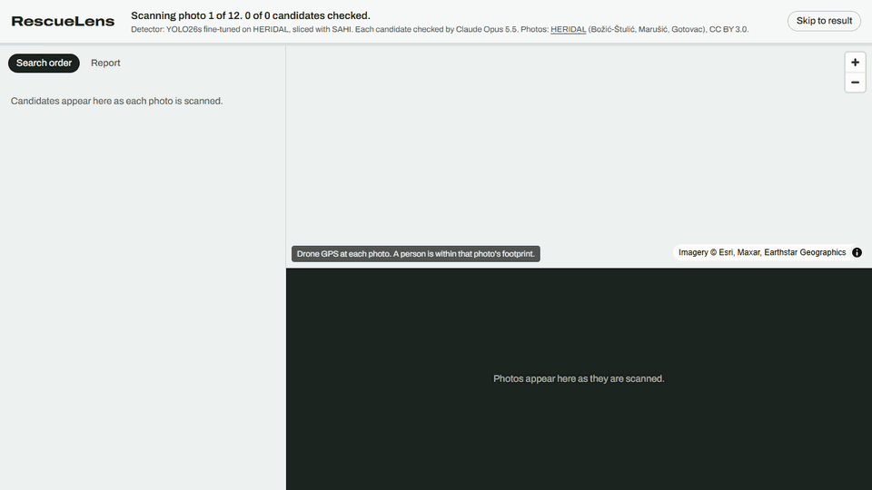

# RescueLens

Find missing people in drone photos. A fine-tuned YOLO detector scans every photo tile by
tile, Claude looks at each candidate and says whether it is a person and how urgent it
looks, and the result is a ranked search list on a map.



A drone photo of a hillside is 4000 × 3000 pixels. A person lying in it covers about
60 × 40 of them, or **0.04 % of the image**. Generic detectors miss most of them, and
the ones they find come with a lot of rocks, bags and shadows. RescueLens does three
things about that:

1. **Slices** each photo into 48 overlapping 640 px tiles (SAHI) so a small person is
   no longer small to the detector.
2. **Detects** with YOLO26s fine-tuned on HERIDAL, a dataset of SAR drone photos.
3. **Verifies** every candidate with Claude vision. Claude gets a close-up and the whole
   frame, answers in a strict JSON schema (person or not, confidence, posture, priority,
   visual evidence) and writes the search brief.

## Results

Official HERIDAL test set: 101 full-resolution photos, 337 annotated people. A detection
counts when it overlaps an annotated person with IoU ≥ 0.5. Full tables and the PR curve
are in [`results/2026-11-12`](results/2026-11-12/README.md); the person-level benchmark
(thresholds chosen on val, bootstrap intervals, recall vs. false alarms) is in
[`docs/evaluation.md`](docs/evaluation.md).

| Detector (conf ≥ 0.25) | AP50 | Recall | Precision | False alarms / photo |
| --- | ---: | ---: | ---: | ---: |
| YOLO26s (COCO), whole photo | 0.310 | 0.187 | 0.708 | 0.26 |
| YOLO26s (COCO) + SAHI | 0.443 | 0.377 | 0.718 | 0.50 |
| **Fine-tuned + SAHI** | **0.782** | **0.846** | 0.561 | 2.21 |

Fine-tuning finds 2.2× more people, but leaves about two false alarms per photo. That is
what Claude is for. Same 409 candidates (detector conf ≥ 0.4), with and without Claude:

| | Recall | Precision | F1 | False alarms / photo | Cost for 101 photos |
| --- | ---: | ---: | ---: | ---: | ---: |
| Detector alone | 0.810 | 0.667 | 0.732 | 1.35 | — |
| + Claude Haiku 5.5 | 0.709 | 0.866 | 0.780 | 0.37 | $0.22 |
| **+ Claude Opus 5.5** | **0.801** | 0.828 | **0.814** | 0.55 | $7.39 |

Opus removes 80 of the 136 false alarms and loses 3 of the 273 people. Haiku removes
more false alarms for 3 % of the price, but drops 34 real people, and in a search a
missed person is the expensive mistake. Opus is the default; Haiku is one setting away
for a cheap first pass. Costs are API list-price equivalents.

## How it works


- **One pipeline, three front ends.** `run_analysis` is an async generator of progress
  events. The CLI prints them, the API streams them over SSE, and the static demo
  re-creates them from a recorded run.
- **Claude never decides alone.** A candidate Claude cannot verify (error, budget hit)
  stays on the list. A search tool should fail open.
- **Reproducible and cheap to re-run.** Verdicts are cached by a hash of model, prompt
  version and image bytes, so re-running an evaluation costs nothing. A hard budget cap
  (`RESCUELENS_MAX_COST_USD`, default $10) stops spending mid-run.
- **Honest positions.** Real EXIF gives the drone's position, not the person's, so the
  map says so. Photos without GPS get a simulated flight path, labelled as simulated.
  RescueLens never mixes the two.

### Claude without an API key

If [Claude Code](https://claude.com/claude-code) is installed, the `claude-code` backend
runs `claude -p` headless with your Claude subscription: no tools, no MCP servers, no
user settings, and the same JSON schema enforced with `--json-schema`. With
`ANTHROPIC_API_KEY` set, the `api` backend calls the Messages API through the official
SDK instead. Choose with `RESCUELENS_LLM_BACKEND=claude-code|api` (see `.env.example`).
All the numbers above were produced with the `claude-code` backend.

## Run it

Requirements: [uv](https://docs.astral.sh/uv/), Node 24, and an NVIDIA GPU for training
(inference runs on CPU, slowly).

```bash
uv tool install rust-just   # task runner (Windows, macOS, Linux)
just setup                  # Python + frontend deps; CUDA torch if a GPU is present
just check                  # lint, types, 113 backend + 10 frontend tests

just download-data          # HERIDAL, 8.3 GB from Zenodo, md5-checked (see DATASET.md)
just prepare-data           # 640 px tiles + full-resolution test photos
uv run rescuelens train     # fine-tune YOLO26s (1.8 h on an RTX 5090 laptop)
just samples                # copy one real flight (12 photos, GPS) to data/samples

just run                    # API on :8731
just ui                     # UI on :5179, then press "Analyse photos"
```

Or from the command line: `uv run rescuelens analyze data/samples/heridal-bra`.

Reproduce the evaluation (the Claude step reads from the cache when it can):

```bash
uv run rescuelens eval detector --weights weights/yolo26s.pt --weights weights/rescuelens-yolo26s-heridal.pt
uv run rescuelens eval llm --preds results/<date>/preds/rescuelens-yolo26s-heridal_sahi.json --conf 0.4
uv run rescuelens eval report
```

Build the static demo from any finished run: `just demo <run_id>` (output in
`frontend/dist`). The [Pages workflow](.github/workflows/pages.yml) publishes it.

## Limitations

- **One dataset.** Trained and tested on HERIDAL: Mediterranean karst in summer, 30–80 m
  altitude. Snow, forest canopy, night or thermal imagery are untested.
- **101 test photos.** Differences of a couple of points between rows are within noise.
- **Positions are photo-level.** With EXIF GPS only, a person is somewhere in the photo's
  footprint around the drone, tens of metres across. Camera heading and lens data would allow per-pixel
  positions; the simulated mode already does this.
- **Claude can be wrong in both directions.** It rejected 3 real people at conf ≥ 0.4, and
  about one in six of the candidates it keeps is still not a person. It ranks the search; it does not
  replace the people doing it.
- **Not an operational tool.** This is a portfolio project, not certified SAR software.

## Project layout

```text
src/rescuelens/
  data/       HERIDAL download (md5), VOC parsing, SAHI-identical tiling
  detect/     YOLO + SAHI wrapper, crops sent to Claude
  verify/     backends (API, Claude Code CLI), schema, cache, cost cap
  ingest/     EXIF GPS, simulated flight paths
  eval/       metrics (AP, PR), detector and Claude ablations, report
  api/        FastAPI app, SSE job runner
  pipeline.py the analysis, as a stream of events
prompts/      versioned prompts (verify_v1, report_v1)
frontend/     React + MapLibre UI, replay and static demo
results/      evaluation outputs, committed
```

## Credits

- **HERIDAL**: D. Božić-Štulić, Ž. Marušić, S. Gotovac, "Deep Learning Approach in Aerial
  Imagery for Supporting Land Search and Rescue Missions", *IJCV* 127, 2019. Copy used:
  [Zenodo 5662351](https://doi.org/10.5281/zenodo.5662351), CC BY 3.0. See
  [DATASET.md](DATASET.md).
- [Ultralytics YOLO26](https://github.com/ultralytics/ultralytics),
  [SAHI](https://github.com/obss/sahi), [MapLibre GL JS](https://maplibre.org/),
  satellite imagery © Esri, Maxar, Earthstar Geographics.
- Built with [Claude Code](https://claude.com/claude-code). Claude Opus 5.5 also does the
  verification and writes the reports.

## License

Code: [AGPL-3.0](LICENSE), required by the Ultralytics dependency. The demo photos in
`frontend/public/demo` are HERIDAL derivatives under CC BY 3.0.
