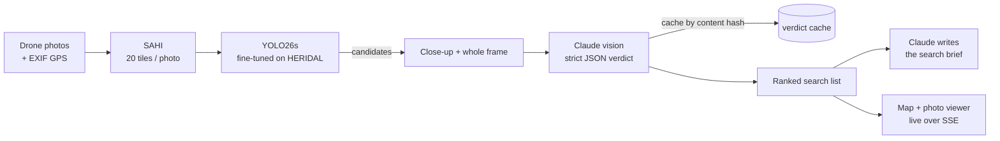

# RescueLens

Find missing people in drone photos. A fine-tuned YOLO detector scans every photo tile by
tile, Claude looks at each candidate and says whether it is a person and how urgent it
looks, and the result is a ranked search list on a map.


A drone photo of a hillside is 4000 × 3000 pixels. A person lying in it covers about
60 × 40 of them, or **0.04 % of the image**. Generic detectors miss most of them, and
the ones they find come with a lot of rocks, bags and shadows. RescueLens does three
things about that:

1. **Slices** each photo into 20 overlapping 1024 px tiles (SAHI), each run at network
   size 1280, so a small person is no longer small to the detector.
2. **Detects** with YOLO26s fine-tuned on HERIDAL, a dataset of SAR drone photos.
3. **Verifies** every candidate with Claude vision. Claude gets a close-up and the whole
   frame, answers in a strict JSON schema (person or not, confidence, posture, priority,
   visual evidence) and writes the search brief.

## Results

Official HERIDAL test set: 101 full-resolution photos, 337 annotated people. Every choice
(tiling, thresholds) was made on the validation split; test was scored once. A person
counts as **found** when a box overlaps them with IoU ≥ 0.1 or a box centre falls inside
them (would a rescuer checking this box see the person?). Intervals are 95 % bootstrap
intervals over photos. Protocol, ablations and limits: [docs/evaluation.md](docs/evaluation.md).

| Detector alone, conf ≥ 0.40 | Photos | People | Recall, found [95 % CI] |
| --- | ---: | ---: | ---: |
| **All test photos** | 101 | 337 | **89.0 % [84.8, 93.4]** |
| Cameras seen in training (DJI FC220, FC300X, Canon S100/S110) | 89 | 261 | 93.9 % [89.7, 97.8] |
| Cameras never seen (DJI FC550, photos without EXIF) | 12 | 76 | 72.4 % [59.6, 80.0] |

At that threshold the detector raises 0.49 [0.32, 0.66] false alarms per photo. Keeping
every box down to conf 0.05 finds 92.6 % [89.2, 95.9] at 2.39 false alarms per photo.

**The camera is the biggest effect measured.** Photos from the two cameras that appear
in neither training nor validation lose about 20 points of recall. Nothing tuned on
HERIDAL's own cameras can show or fix that; it needs data from other cameras.

Detection takes 0.52 s per 4000 × 3000 photo (median, RTX 5090 Laptop GPU). With the
stricter literature criterion (IoU ≥ 0.5, duplicates count as false positives) recall at
conf 0.40 is 87.2 % [82.8, 91.8].

**How it got there.** The first version reached 86.1 % (found, conf 0.40) with 1.17 false
alarms per photo. A benchmark on the validation split showed that sliced inference was
upscaling every 640 px tile 2×, outside the scale the detector was trained on. Fixing the
tiling gave +3.0 points [+1.0, +4.8] on the same test photos and halved the false alarms.
Stronger zoom augmentation, flip test-time augmentation, model ensembles and hard
negative mining were each tried on validation and none gave a gain whose interval
excluded zero, so none was kept.

### Claude as a verifier

Measured with the first detector (640 px tiles), on its 409 candidates at conf ≥ 0.4,
criterion IoU ≥ 0.5. It has not been re-run with the current detector.

| | Recall | Precision | F1 | False alarms / photo | Cost for 101 photos |
| --- | ---: | ---: | ---: | ---: | ---: |
| Detector alone | 0.810 | 0.667 | 0.732 | 1.35 | — |
| + Claude Haiku 5.5 | 0.709 | 0.866 | 0.780 | 0.37 | $0.22 |
| **+ Claude Opus 5.5** | **0.801** | 0.828 | **0.814** | 0.55 | $7.39 |

Opus removes 80 of the 136 false alarms and loses 3 of the 273 people. Haiku removes
more false alarms for 3 % of the price, but drops 34 real people, and in a search a
missed person is the expensive mistake. Opus is the default; Haiku is one setting away
for a cheap first pass. Costs are API list-price equivalents. Detector-level tables from
that first run (COCO vs fine-tuned, AP50, PR curve) are in
[`results/2026-11-12`](results/2026-11-12/README.md).

## How it works



- **One pipeline, three front ends.** `run_analysis` is an async generator of progress
  events. The CLI prints them, the API streams them over SSE, and the static demo
  re-creates them from a recorded run.
- **Claude never decides alone.** A candidate Claude rules out is not deleted: its box
  stays on the photo and it moves to a "ruled out" list one click away. A candidate Claude
  cannot verify (error, budget hit) stays on the main list. A search tool should fail open.
  Claude's confidence only orders candidates within a priority tier; it is never a threshold.
- **Reproducible and cheap to re-run.** Verdicts are cached by a hash of model, prompt
  version and image bytes, so re-running an evaluation costs nothing. A hard budget cap
  (`RESCUELENS_MAX_COST_USD`, default $10) stops spending mid-run.
- **Honest positions.** Real EXIF gives the drone's position, not the person's, so the
  map says so. Photos without GPS get a simulated flight path, labelled as simulated.
  RescueLens never mixes the two.

### Develop on a subscription, deploy on the API

For development, the `claude-code` backend runs [Claude Code](https://claude.com/claude-code)
headless (`claude -p`) with your own Claude subscription: no tools, no MCP servers, no
user settings, and the same JSON schema enforced with `--json-schema`. Anything that serves
other people should use the `api` backend, which calls the Messages API through the
official SDK with `ANTHROPIC_API_KEY`, as Anthropic's
[terms for Claude Code](https://code.claude.com/docs/en/legal-and-compliance) require for
products and services. Choose with `RESCUELENS_LLM_BACKEND=claude-code|api` (see
`.env.example`). All the Claude numbers above were produced with the `claude-code` backend.

## Run it

Requirements: [uv](https://docs.astral.sh/uv/), Node 24, and an NVIDIA GPU for training
(inference runs on CPU, slowly).

**The fine-tuned weights are not published.** To detect people you train them yourself
from the public COCO checkpoint (about 2 h on an RTX 5090 laptop GPU). The static demo
replays a recorded run and needs no weights.

```bash
uv tool install rust-just   # task runner (Windows, macOS, Linux)
just setup                  # Python + frontend deps; CUDA torch if a GPU is present
just check                  # lint, types, 121 backend + 10 frontend tests

just download-data          # HERIDAL, 8.3 GB from Zenodo, md5-checked (see DATASET.md)
just prepare-data           # 640 px training tiles + full-resolution test photos
just cli train              # fine-tune YOLO26s on the tiles
just samples                # copy one real flight (12 photos, GPS) to data/samples

just run                    # API on :8731
just ui                     # UI on :5179, then press "Analyse photos"
```

Or from the command line: `just cli analyze data/samples/heridal-bra`. Use `just cli ...`
rather than a bare `uv run`: `just` passes the CUDA extra, and a bare `uv run` re-syncs
the environment to the CPU build of PyTorch.

Reproduce the person-level benchmark (thresholds chosen on val, test scored once):

```bash
just bench                  # results/bench/A5-s1024-i1280.md
just cli bench --help       # ablations on val: bench val, compare, fuse, latency
```

Reproduce the Claude verification run (it reads verdicts from the cache when it can):

```bash
just cli eval detector --weights weights/yolo26s.pt --weights weights/rescuelens-yolo26s-heridal.pt
just cli eval llm --preds results/<date>/preds/rescuelens-yolo26s-heridal_sahi.json --conf 0.4
just cli eval report
```

Build the static demo from any finished run: `just demo <run_id>` (output in
`frontend/dist`). The [Pages workflow](.github/workflows/pages.yml) publishes it.

## Limitations

- **New cameras.** Recall drops from 93.9 % to 72.4 % on test photos from cameras not
  seen in training (12 photos, so the second number is uncertain: 59.6–80.0 %). Expect a
  similar drop on any drone not in HERIDAL until it is evaluated on that camera.
- **One dataset.** Trained and tested on HERIDAL: Mediterranean karst in summer, 30–80 m
  altitude. Snow, forest canopy, night or thermal imagery are untested.
- **101 test photos.** Differences of a couple of points between rows are within noise.
- **Positions are photo-level.** With EXIF GPS only, a person is somewhere in the photo's
  footprint around the drone, tens of metres across. Camera heading and lens data would allow per-pixel
  positions; the simulated mode already does this.
- **Claude can be wrong in both directions.** It rejected 3 real people at conf ≥ 0.4, and
  about one in six of the candidates it keeps is still not a person. It ranks the search; it does not
  replace the people doing it.
- **Not an operational tool.** This is a portfolio project, not certified SAR software.

## Project layout

```text
src/rescuelens/
  data/       HERIDAL download (md5), VOC parsing, SAHI-identical tiling, hard negatives
  detect/     YOLO + SAHI wrapper, box fusion, crops sent to Claude
  verify/     backends (API, Claude Code CLI), schema, cache, cost cap
  ingest/     EXIF GPS, simulated flight paths
  eval/       person-level benchmark (bootstrap, val/test protocol), ablations, report
  api/        FastAPI app, SSE job runner
  pipeline.py the analysis, as a stream of events
prompts/      versioned prompts (verify_v1, report_v1)
frontend/     React + MapLibre UI, replay and static demo
results/      evaluation outputs, committed
```

## Credits

- **HERIDAL**: D. Božić-Štulić, Ž. Marušić, S. Gotovac, "Deep Learning Approach in Aerial
  Imagery for Supporting Land Search and Rescue Missions", *IJCV* 127, 2019. Copy used:
  [Zenodo 5662351](https://doi.org/10.5281/zenodo.5662351), CC BY 3.0. See
  [DATASET.md](DATASET.md).
- [Ultralytics YOLO26](https://github.com/ultralytics/ultralytics),
  [SAHI](https://github.com/obss/sahi), [MapLibre GL JS](https://maplibre.org/),
  satellite imagery © Esri, Maxar, Earthstar Geographics.
- Built with [Claude Code](https://claude.com/claude-code). Claude Opus 5.5 also does the
  verification and writes the reports.

## License

Code: [AGPL-3.0](LICENSE), required by the Ultralytics dependency. The demo photos in
`frontend/public/demo` are HERIDAL derivatives under CC BY 3.0.
