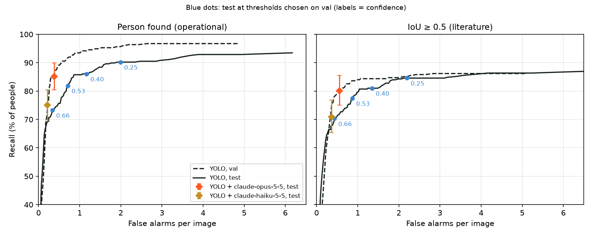

# Evaluation

How RescueLens is measured, what the numbers are, and what they do not say. Everything
here is reproducible with `just bench` (see [Reproduce](#reproduce)); raw outputs are in
[`results/bench`](../results/bench).

## Protocol

**Splits.** HERIDAL's official splits, never reshuffled: train (1,391 photos) for
training, **val (155 photos, 275 people) for every choice** (thresholds, and later
ablations), **test (101 photos, 337 people) scored once per final configuration**. A
threshold that appears in a test table was fixed on val (or before this benchmark existed,
which is said explicitly).

**Unit.** People, not boxes. Each annotated person is either found or missed. All rates
are pooled over the split (total found / total people), not averaged per photo.

**Two hit criteria**, both always reported:

| | Criterion | Duplicates (2nd box on a found person) |
|---|---|---|
| `found` (operational) | IoU ≥ 0.1, or either box's centre inside the other | not a person found twice, not a false alarm |
| `iou50` (literature) | IoU ≥ 0.5 | false positive (PASCAL VOC) |

People in HERIDAL are ~60 px wide in a 4000 px photo. A box that is 10 px off still
sends a rescuer to the right spot, but at that size it can drop below IoU 0.5. `found`
asks the operational question: would someone checking this detection see the person?
`iou50` keeps the numbers comparable with papers.

Matching is greedy and one-to-one, highest score first. A prediction's label then only
depends on higher-scored predictions, so lowering the threshold never relabels anything
above it, and recall/false-alarm curves are exact.

**Uncertainty.** 95 % percentile bootstrap, 2,000 replicates, resampling whole photos
(people in a photo are not independent: same scene, same altitude, same light).

**False alarms per km².** EXIF gives the lens but not the height above ground
(`GPSAltitude` is above sea level), so the footprint assumes a **nadir camera at 50 m
above ground**, the middle of HERIDAL's reported 30–80 m. Per-photo footprints come from
each camera's 35 mm-equivalent focal length. False alarms per km² scale with
(50 m / real altitude)², so at 30 m they would be 2.8× higher and at 80 m 0.39×.

| Camera (EXIF) | 35 mm-eq. focal | Footprint at 50 m | GSD at 50 m | Val photos | Test photos |
|---|---:|---:|---:|---:|---:|
| DJI FC220 (Mavic Pro) | 26 mm | 3,323 m² | 1.7 cm | 109 | 17 |
| DJI FC300X (Phantom 3) | 20 mm | 5,616 m² | 2.2 cm | 31 | 49 |
| Canon PowerShot S100/S110 | 24 mm | 3,900 m² | 1.8 cm | 15 | 23 |
| DJI FC550 (Inspire 1, 16:9) | 30 mm | 2,222 m² | 1.6 cm | 0 | 4 |
| no EXIF (24 mm assumed) | 24 mm | 3,900 m² | 1.8 cm | 0 | 8 |

**Latency** is wall-clock per photo on an RTX 5090 Laptop GPU, after one warm-up photo:
detector only (tiling, inference, merging), and with JPEG decoding. **Cost** is API
list-price equivalent; the detector runs locally and costs nothing per photo.

## Results: phase 0 baseline

Detector: YOLO26s fine-tuned on HERIDAL, SAHI with 640 px tiles and 20 % overlap. Full
tables, with every interval, are in
[`results/bench/rescuelens-yolo26s-heridal_sahi.md`](../results/bench/rescuelens-yolo26s-heridal_sahi.md).



**Test, person found (operational).** Thresholds in the first column were chosen on val.
95 % bootstrap intervals in brackets.

| Configuration | Conf | People found | Recall % | False alarms / photo | False alarms / km² (50 m) | Cost / photo | Latency / photo p50 · p95 |
|---|---:|---:|---:|---:|---:|---:|---:|
| YOLO, product default | 0.40 | 290 / 337 | 86.1 [81.6, 90.9] | 1.17 [0.93, 1.43] | 256 [204, 313] | $0 | 1.17 · 1.59 s |
| YOLO, recall ≥ 90 % on val | 0.53 | 276 / 337 | 81.9 [76.5, 87.7] | 0.71 [0.53, 0.91] | 156 [117, 198] | $0 | same |
| YOLO, recall ≥ 95 % on val | 0.25 | 304 / 337 | 90.2 [86.2, 94.1] | 1.99 [1.61, 2.39] | 436 [355, 527] | $0 | same |
| YOLO, lowest score kept | 0.05 | 315 / 337 | 93.5 | 6.17 | 1,350 | $0 | same |
| YOLO + Claude Opus 5.5 | 0.40 | 287 / 337 | 85.2 [80.4, 89.9] | 0.38 [0.24, 0.52] | 82 [53, 115] | $0.073 | + 4.2 · 8.2 s per call |
| YOLO + Claude Haiku 5.5 | 0.40 | 253 / 337 | 75.1 [69.8, 80.5] | 0.22 [0.11, 0.33] | 48 [25, 72] | $0.002 | + 3.9 · 5.7 s per call |

Detector latency excludes JPEG decoding (+0.1 s). Claude latency is per candidate; a photo
has 4 candidates on average and the app verifies 6 at a time. With IoU ≥ 0.5 the same
rows read 81.0 % (product default), 80.1 % (+ Opus) and 70.9 % (+ Haiku) recall, matching
the [earlier evaluation](../results/2026-11-12/README.md) exactly.

What this says:

1. **Thresholds do not reach high recall.** With every box down to score 0.05 kept,
   recall on test stops at 93.5 % (22 people get no box at all) at 6 false alarms per
   photo. No threshold, filter or re-ranking after the detector can find those 22.
   Recall has to come from the detector itself (phase 1).
2. **Recall targets set on val undershoot on test.** A threshold that gives 95 % recall
   on val gives 90 % on test; one that gives 90 % gives 82 %. In the operational plot the
   val curve sits above the test curve at every false-alarm rate.
3. **The gap is a camera gap.** Train and val contain three cameras (DJI FC220, DJI
   FC300X, Canon S110). Test adds 4 photos from a DJI FC550 and 8 photos without EXIF,
   **76 of its 337 people**, and recall there is 67 % at conf 0.40. On the three known
   cameras (counting one Canon S100 photo with its sibling, the S110), test recall at
   0.40 is 239 / 261 = 91.6 %, close to val (93.5 %). This
   breakdown is descriptive (it was looked at after the fact, and was not used to choose
   anything).
4. **Claude buys precision, not recall.** Opus cuts false alarms by two thirds (1.17 →
   0.38 per photo) and loses 3 people, at $0.07 and several seconds per photo. It cannot
   recover a person the detector never boxed. Haiku is 33× cheaper but loses 37 people.

## Phase 1.1: who gets missed? (val)

Full tables: [`results/bench/strata_rescuelens-yolo26s-heridal_sahi.md`](../results/bench/strata_rescuelens-yolo26s-heridal_sahi.md).
Person size is √(w·h) of the annotated box. Ground resolution (GSD) comes from DJI's XMP
`RelativeAltitude`, which is height above the **take-off point**; Canon photos have none.

**Val, criterion: person found, conf 0.40**

| Person size | People | Recall % [95 % CI] |
|---|---:|---:|
| 30–40 px | 16 | 81.2 [62.5, 100] |
| 40–50 px | 42 | 88.1 [75.0, 100] |
| 50–60 px | 57 | 93.0 [86.0, 100] |
| 60–80 px | 116 | 97.4 [94.1, 100] |
| 80–120 px | 43 | 93.0 [85.2, 100] |

With IoU ≥ 0.5 the same bins read 68.8, 81.0, 82.5, 89.7 and 81.4 %. Small people are
missed more often. Within val's GSD range (1.25–2.5 cm/px) recall shows no trend (94–100 %
per bin, criterion: found).

**Is the FC550 drop a camera effect or a scale effect?** Val has no FC550 photo, so val
alone cannot answer "camera"; it can answer "scale". Test was only *described* for this
(annotation sizes and EXIF; no new predictions were scored):

| Test group | People | Median size | Share < 40 px | Recall expected from size alone (val curve) | Recall observed (phase 0, found, conf 0.40) |
|---|---:|---:|---:|---:|---:|
| DJI FC550 | 42 | 53 px | 2 % | 91.7 % | 66.7 % |
| no EXIF | 34 | 53 px | 15 % | 91.6 % | 67.6 % |
| FC300X | 106 | 51 px | 20 % | 90.0 % | 98.1 % |

FC550 people are as large in pixels as everyone else, so pixel scale explains at most a
few points of the 25-point drop. The FC550 photos were flown much higher than anything in
train (82–124 m above take-off, train ≤ 77 m), but the people still measure ~53 px; with
their GSD from EXIF they would be 1.5 m across, against ~1.0 m for FC220 and FC300X, so
the ground under these photos must sit well above the take-off point and EXIF altitude
overstates the real one. What differs is therefore not size but something else about these
photos: camera and lens (Zenmuse X5, 16:9), terrain, light, or pose. With 4 photos (and 8
without EXIF) this cannot be narrowed down further, and doing so would mean studying test.
**Consequence:** normalising scale will not fix this group; more varied training data
(other cameras and terrain) is the lever.

## Limitations

- **One dataset, small test set.** 101 test photos; recall intervals are about ±5 points
  wide. Differences inside the intervals are not evidence.
- **Unseen cameras in test.** See point 3. Val cannot tell us how a threshold behaves on a
  camera it does not contain, so a recall target set on val is optimistic for new
  hardware.
- **Assumed altitude.** False alarms per km² rely on 50 m above ground for every photo.
- **Claude arms are test-only.** Their candidates (conf ≥ 0.40) and prompt were fixed
  before this benchmark; no Claude threshold was tuned. There are no Claude verdicts on
  val (they would cost about $7), so the Claude rows have no val counterpart.
- **Latency is one machine.** RTX 5090 Laptop GPU, plugged in. On battery the GPU clocks
  down and the detector is several times slower.

## Reproduce

```bash
just bench                     # = rescuelens data full --split val + rescuelens bench run
uv run rescuelens bench run --claude results/2026-11-12/verdicts/<file>.json   # add Claude arms
```

Predictions are cached in `results/bench/preds`, so re-scoring takes seconds. CI scores
real predictions for 12 test photos (`tests/fixtures/bench_small`, coordinates only) and
fails if any number or interval changes.
