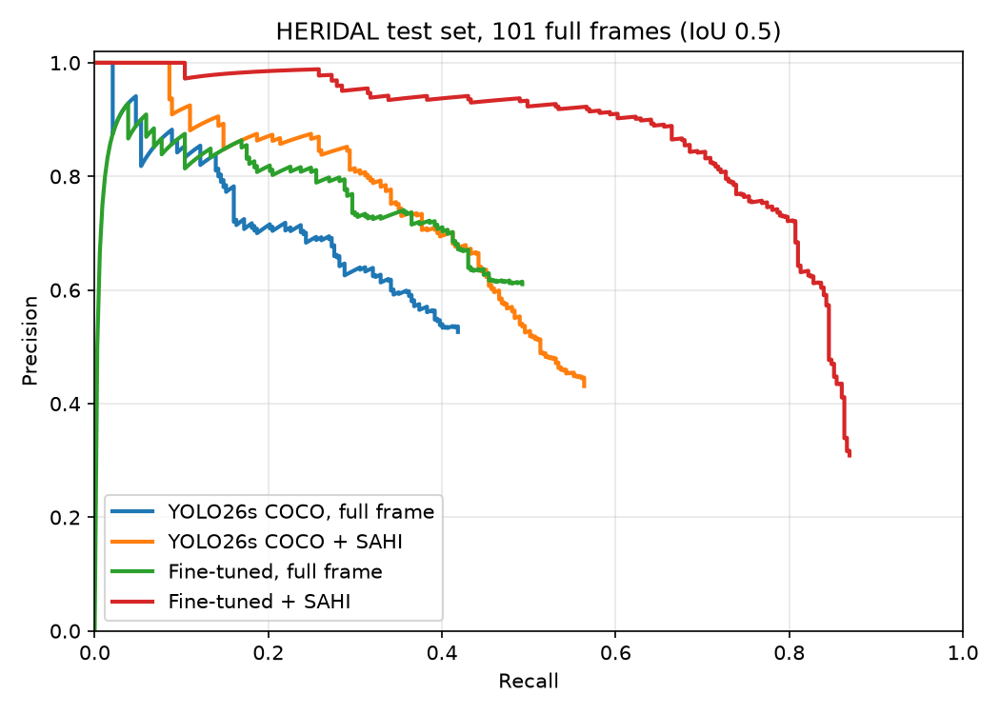

# RescueLens evaluation — 2026-11-12

Official HERIDAL test set: 101 full-resolution frames, 337 annotated people. A detection is correct when IoU ≥ 0.5 with an unmatched ground-truth box. Precision, recall, F1 and FP/image are at detector confidence ≥ 0.25. Generated by `rescuelens eval report` from the JSON files in this folder.

## Detector

| Detector | AP50 | AP50-95 | Precision | Recall | F1 | FP / image | Best F1 (conf) | s / frame |
|---|---:|---:|---:|---:|---:|---:|---:|---:|
| YOLO26s COCO + SAHI | 0.443 | 0.232 | 0.718 | 0.377 | 0.494 | 0.50 | 0.531 (0.18) | 1.61 |
| YOLO26s COCO, full frame | 0.310 | 0.139 | 0.708 | 0.187 | 0.296 | 0.26 | 0.470 (0.05) | 0.09 |
| Fine-tuned + SAHI | 0.782 | 0.489 | 0.561 | 0.846 | 0.675 | 2.21 | 0.767 (0.66) | 1.57 |
| Fine-tuned, full frame | 0.389 | 0.180 | 0.719 | 0.365 | 0.484 | 0.48 | 0.547 (0.05) | 0.08 |

## Claude verification

Each candidate is sent to Claude as in production (crop + context, prompt `verify_v1`, strict JSON schema). *Filter* drops candidates Claude rejects; *re-ranked* scores every candidate by Claude's p(person). Unverified candidates are kept (fail open). Costs are API list-price equivalents.

| Candidates | Model | Variant | Precision | Recall | F1 | FP / image | AP50 | Cost (USD) | p50 latency |
|---|---|---|---:|---:|---:|---:|---:|---:|---:|
| 508 (conf ≥ 0.25) | claude-haiku-5-5 | YOLO alone | 0.561 | 0.846 | 0.675 | 2.21 | 0.772 | - | - |
| 508 (conf ≥ 0.25) | claude-haiku-5-5 | YOLO + Claude (filter) | 0.841 | 0.739 | 0.787 | 0.47 | 0.702 | 0.27 | 3.9 s |
| 508 (conf ≥ 0.25) | claude-haiku-5-5 | YOLO + Claude (re-ranked) | 0.830 | 0.780 | 0.804 | 0.53 | 0.763 | 0.27 | 3.9 s |
| 409 (conf ≥ 0.4) | claude-haiku-5-5 | YOLO alone | 0.667 | 0.810 | 0.732 | 1.35 | 0.750 | - | - |
| 409 (conf ≥ 0.4) | claude-haiku-5-5 | YOLO + Claude (filter) | 0.866 | 0.709 | 0.780 | 0.37 | 0.677 | 0.22 | 3.9 s |
| 409 (conf ≥ 0.4) | claude-haiku-5-5 | YOLO + Claude (re-ranked) | 0.858 | 0.751 | 0.801 | 0.42 | 0.740 | 0.22 | 3.9 s |
| 409 (conf ≥ 0.4) | claude-opus-5-5 | YOLO alone | 0.667 | 0.810 | 0.732 | 1.35 | 0.750 | - | - |
| 409 (conf ≥ 0.4) | claude-opus-5-5 | YOLO + Claude (filter) | 0.828 | 0.801 | 0.814 | 0.55 | 0.761 | 7.39 | 4.2 s |
| 409 (conf ≥ 0.4) | claude-opus-5-5 | YOLO + Claude (re-ranked) | 0.828 | 0.801 | 0.814 | 0.55 | 0.752 | 7.39 | 4.2 s |
